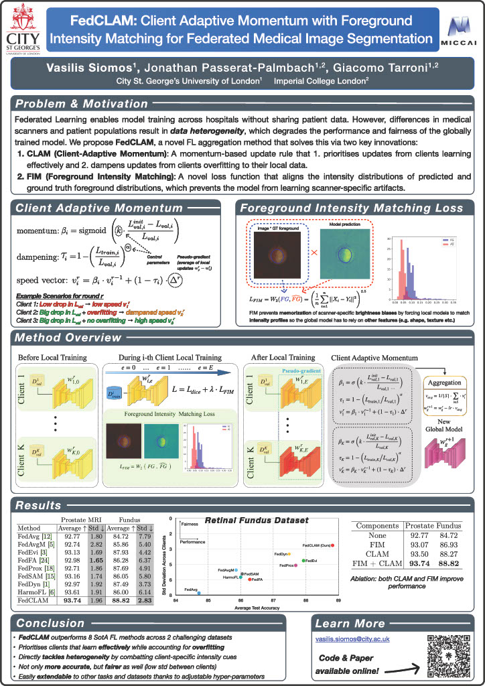

# FedCLAM: Client Adaptive Momentum with Foreground Intensity Matching for Federated Medical Image Segmentation

[](https://arxiv.org/abs/XXXX.XXXXX)
[](https://opensource.org/licenses/MIT)

Official PyTorch implementation of our MICCAI 2025 spotlight paper **FedCLAM**.
## Abstract
> Federated learning is a decentralized training approach that keeps data under stakeholder control while achieving superior performance over isolated training. While inter-institutional feature discrepancies pose a challenge in all federated settings, medical imaging is particularly affected due to diverse imaging devices and population variances, which can diminish the global model's effectiveness. Existing aggregation methods generally fail to adapt across varied circumstances. To address this, we propose FedCLAM, which integrates **client-adaptive momentum** terms derived from each client's loss reduction during local training, as well as a **personalized dampening** factor to curb overfitting. We further introduce a novel **intensity alignment loss** that matches predicted and ground-truth foreground distributions to handle heterogeneous image intensity profiles across institutions and devices. Extensive evaluations on two datasets show that FedCLAM surpasses eight cutting-edge methods in medical segmentation tasks, underscoring its efficacy.



## 📌 Key Features
- **Client-adaptive momentum-based Aggregation:** Implements client-specific momentum (`β_i`) and dampening (`τ_i`) for robust federated optimization in heterogeneous environments.
- **Intensity Alignment:** Introduces the FIM loss based on the Wasserstein distance to handle inter-site intensity heterogeneity.
- **State-of-the-Art Results:** Achieves superior performance and fairness on retinal fundus and prostate MRI segmentation tasks.
- **Minimal Tuning:** Designed to be robust and work well with default hyperparameters.

## 📋 Results

### Retinal Fundus (Optic Disc & Cup) Segmentation
| Method | Avg. Dice ↑ | Std. Dev. (Fairness) ↓ |
|:---|:---:|:---:|
| FedAvg | 84.72 | 7.79 |
| FedProx | 87.69 | 4.91 |
| FedDyn | 87.49 | 3.73 |
| **FedCLAM (Ours)** | **88.82** | **2.83** |

### Prostate MRI Segmentation
| Method | Avg. Dice ↑ | Std. Dev. (Fairness) ↓ |
|:---|:---:|:---:|
| FedAvg | 92.77 | 1.80 |
| HarmoFL | 93.61 | 1.91 |
| **FedCLAM (Ours)** | **93.74** | 1.96 |

*Please refer to the paper for detailed results per client and additional comparisons.*

---

## 🚀 Getting Started

### 1. Installation
Clone the repository and install dependencies:
```bash
git clone https://github.com/siomvas/FedCLAM.git
cd FedCLAM
pip install -r requirements.txt
```
### 2. Data Pre-processing
To use the datasets from the paper, download the original data from:
* Prostate MRI: https://liuquande.github.io/SAML/
* Retinal Fundus:
  * RIM-ONE: https://drive.google.com/file/d/1teYi_smpLiNZNJcTWdxXgKKLW2fkUQr4/view
  * REFUGE: https://figshare.com/articles/figure/Refuge/26049574?file=47095942
  * Drishti-GS: https://cvit.iiit.ac.in/projects/mip/drishti-gs/mip-dataset2/Home.php

Then replace the `base_path` and `save_path` variables in `/pyfed/dataset/preprocess_prostate.py` and `/pyfed/dataset/preprocess_fundus.py`, respectively. The file `pyfed/dataset/utils.py` also contains utilities to split the datasets into non-IID chunks using the Dirichlet method for further experimentation.

Finally, replace the `self.DIR_DATA` variable in `config/fundus/base.py` and `config/prostate_mri/base.py` with the preprocessed dataset paths (`save_path`s from previous step).

### 3. Example experiments & reproducing results from the paper
The folder `run_scripts` contains sample scripts to replicate the baseline and **FedCLAM** results presented in the paper on the prostate and fundus datasets.

---

## Reproducibility notes for this repository

The paper text, the original public code, and some released scripts use slightly different default parameters. For grading or independent reruns, use the information in this section together with the committed code in this repository.

### Runtime environment

The experiments for this repository were run on an A100 server with:

```text
Operating system: Rocky Linux 9.7 (Blue Onyx)
Python: 3.9.25
```

Use the repository dependency files to recreate the Python environment:

```bash
conda env create -f environment.yml
conda activate fedclam
pip install -r requirements.txt
```

If an existing Conda environment is used instead, keep the package versions compatible with `requirements.txt` or `requirements-lock.txt`.

### Code version

Record the exact code version before rerunning experiments:

```bash
git rev-parse HEAD
```

The validation/test split fix is included from commit:

```text
1b58946 Prevent validation split from using test data
```

For later reruns, report the commit returned by `git rev-parse HEAD` in the experiment log.

### Data directory structure

The code expects preprocessed `.npy` data. Set the dataset roots with environment variables rather than hard-coding paths:

```bash
export FEDCLAM_FUNDUS_DATA=/path/to/fundus/official
export FEDCLAM_PROSTATE_DATA=/path/to/prostate/official
export FEDCLAM_NUCLEI_DATA=/path/to/nuclei/official
export FEDCLAM_OUTPUT_DIR=/path/to/outputs
```

Fundus and nuclei directories use one folder per client:

```text
official/
  Drishti-GS/
    train/image/*.npy
    train/mask/*.npy
    valid/image/*.npy      # optional; if absent, validation is split from train
    valid/mask/*.npy
    test/image/*.npy
    test/mask/*.npy
  RIM-ONE/
  REFUGE_t/
  REFUGE_v/
```

Extended fundus uses the same layout with:

```text
official/
  REFUGE2/
  G1020/
  ORIGA/
```

Extended nuclei uses the same layout with:

```text
official/
  TNBC/
  CPM17/
  CoNSeP/
```

Prostate uses one preprocessed directory per client:

```text
official/
  BIDMC_data/
    train.npy
    valid.npy
    test.npy
  HK_data/
  I2CVB_data/
  BMC_data/
  RUNMC_data/
  UCL_data/
```

### Complete run commands

Run from the repository root. The scripts accept environment variables for output locations, GPU selection, and data roots.

Hyperparameter validation on fundus and prostate:

```bash
bash scripts/run_fedclam_hparam_sweep.sh fundus
bash scripts/run_fedclam_hparam_sweep.sh prostate
```

For the RIM-ONE fundus runs used in this project, set `FEDCLAM_FUNDUS_DATA` to the crop diagnostic preprocessed data before running the fundus sweep.

Backbone ablation on fundus and prostate:

```bash
bash scripts/run_rimone_crop_hparam_backbone.sh
bash scripts/run_backbone_ablation.sh
```

Extended dataset FedCLAM experiments:

```bash
bash scripts/run_ordered_extended_fedclam.sh
```

Extended dataset FedAvg baseline:

```bash
python main.py --config config.nuclei.fedavg --protocol strict --seed 0 --exp_name fedavg_extended_group1_TNBC_CPM17_CoNSeP_seed0
python main.py --config config.nuclei.fedavg --protocol strict --seed 1 --exp_name fedavg_extended_group1_TNBC_CPM17_CoNSeP_seed1
python main.py --config config.nuclei.fedavg --protocol strict --seed 2 --exp_name fedavg_extended_group1_TNBC_CPM17_CoNSeP_seed2
python main.py --config config.fundus.fedavg --protocol strict --seed 0 --exp_name fedavg_extended_group2_REFUGE2_G1020_ORIGA_seed0
python main.py --config config.fundus.fedavg --protocol strict --seed 1 --exp_name fedavg_extended_group2_REFUGE2_G1020_ORIGA_seed1
python main.py --config config.fundus.fedavg --protocol strict --seed 2 --exp_name fedavg_extended_group2_REFUGE2_G1020_ORIGA_seed2
```

### Experiment configuration and seeds

| Experiment group | Dataset/clients | Config files | Seeds |
| --- | --- | --- | --- |
| Hyperparameter validation | Fundus: Drishti-GS, RIM-ONE, REFUGE_t, REFUGE_v | `config/fundus/fedclam.py` | 0 |
| Hyperparameter validation | Prostate: BIDMC, HK, I2CVB, BMC, RUNMC, UCL | `config/prostate_mri/fedclam.py` | 0 |
| Backbone ablation | Fundus crop diagnostic | `config/fundus/fedclam.py`, `fedclam_resenc.py`, `fedclam_resenc_ds.py`, `fedclam_resenc_scse.py`, `fedclam_resenc_ag.py`, `fedclam_resattunet.py` | 0 |
| Backbone ablation | Prostate | `config/prostate_mri/fedclam.py`, `fedclam_resenc.py`, `fedclam_resenc_ds.py`, `fedclam_resenc_scse.py`, `fedclam_resenc_ag.py`, `fedclam_resattunet.py` | 0 |
| Extended FedCLAM | TNBC, CPM17, CoNSeP | `config/nuclei/fedclam.py` | 0, 1, 2 |
| Extended FedCLAM | REFUGE2, G1020, ORIGA | `config/fundus/fedclam.py` | 0, 1, 2 |
| Extended FedAvg | TNBC, CPM17, CoNSeP | `config/nuclei/fedavg.py` | 0, 1, 2 |
| Extended FedAvg | REFUGE2, G1020, ORIGA | `config/fundus/fedavg.py` | 0, 1, 2 |

The hyperparameter sweep values are encoded in `scripts/run_fedclam_hparam_sweep.sh`: learning rate, batch size, local epochs, dampening exponent `alpha`, and weight decay. The backbone variants are encoded by the `fedclam_res*` config files listed above.

---

## 🧠 Code Structure -- Modifying & Extending the Codebase
### 1. Configuration files
Every dataset needs a `base.py` configuration file which specifies training parameters as well as directories to load and save data. On top of this, for each aggregation method another configuration file specifies any method-specific parameters.
### 2. Control flow/adding a new method
The `Manager` class controls program execution, by instantiating a `Comm` (communicator) as well as `Client` objects of the relevant class/aggregation method. To add a new aggregation method, create the relevant `Client` class which specifies how the clients train locally, and the corresponding `Comm` class which specifies the aggregation rule.

---

## 🙏 Acknowledgements 
Credits to the author of FedFA (https://github.com/tfzhou/FedFA) whose code structure/scaffolding I've borrowed for this project.

---
## 📜 Citation
If you find the code and paper useful, please cite our paper which you can find here:
https://link.springer.com/chapter/10.1007/978-3-032-04978-0_24
